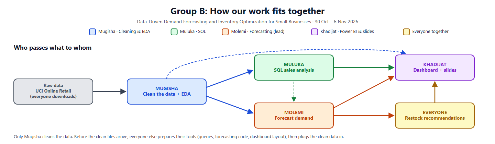

# Data-Driven Demand Forecasting and Inventory Optimization for Small Businesses

**WTM Tech Mentorship 2026 · Data Science · Group B**

We use one year of real sales data from a small online shop to predict how much of its 10 best-selling products it will sell in the coming weeks, and turn those predictions into simple restock recommendations.

> **Status:** in progress (sprint 30 October – 6 November 2026). Sections marked *To be completed* will be filled in as each part is finished.

---

## The problem

Many small businesses decide what to restock by guesswork. Popular products run out and lose sales, while slow products sit on the shelf and tie up money.

**Who this is for:** owners and managers of small retail businesses who have sales records but no forecasting tools.

## Our question and answer

**Question:** A small shop: how much of each product will it sell in the coming weeks, and what should it buy more of?

**Our answer has two parts:**

| Part | It says |
|---|---|
| **1. Forecast** | "This product will sell about **50 a week**." |
| **2. Restock** | "So **buy more of it now**." (or "You have enough, don't buy.") |

**Like a weather forecast:** the forecast says *"It will rain tomorrow."* The restock part says *"So take an umbrella."* The forecast tells us what will happen; the restock part tells the shop owner what to do about it.

---

## The data

| | |
|---|---|
| **Dataset** | [Online Retail](https://archive.ics.uci.edu/dataset/352/online+retail), UCI Machine Learning Repository |
| **Business** | A UK-based online shop selling all-occasion gifts. Many of its customers are wholesalers. |
| **Period** | 1 December 2010 – 9 December 2011 (about one year) |
| **Size** | 541,909 rows (one row per product line on an invoice), about 4,000 products |
| **Columns** | `InvoiceNo`, `StockCode`, `Description`, `Quantity`, `InvoiceDate`, `UnitPrice`, `CustomerID`, `Country` |
| **File** | `Online Retail.xlsx` (Excel, 22.6 MB) |
| **Licence** | [CC BY 4.0](https://creativecommons.org/licenses/by/4.0/) |
| **Citation** | Chen, D. (2015). *Online Retail* [Dataset]. UCI Machine Learning Repository. https://doi.org/10.24432/C5BW33 |

The raw file is **not stored in this repo** (it's too large). Download it from the UCI link above or from our shared Google Drive folder, and place it in `data/raw/`.

**What the data does not have:** stock levels and supplier delivery times. Our restock recommendations therefore use clearly stated assumptions (see [Restock recommendations](#restock-recommendations)).

---

## How the work flows



1. **Mugisha cleans the data** and shares the clean files with everyone.
2. **Muluka** takes the clean data and uses SQL to describe **the whole shop's past**: busy months, best and worst sellers, countries, and which products bring in most of the money. Muluka also finds the **top 10 products**.
3. **Molemi** takes the clean data and forecasts **the future for the top 10 products only**: how many of each will sell in the next 4 weeks.
4. **Khadijat** takes Muluka's results and Molemi's forecasts and builds the Power BI dashboard and the slides.
5. **Together**, we turn the forecasts into restock recommendations.

| | Muluka | Molemi |
|---|---|---|
| Looks at | The past | The future |
| Products | All (plus picks the top 10) | Top 10 only |
| Answers | "What happened in this shop?" | "What will happen next?" |

### Hand-offs between team members

| What | From → To | Due | File |
|---|---|---|---|
| Clean data | Mugisha → everyone | Sat 31 Oct | `data/processed/sales_clean.csv` |
| Weekly sales table | Mugisha → Molemi, Khadijat | Sat 31 Oct | `data/processed/weekly_sales.csv` (`week_start, StockCode, Description, quantity, revenue`) |
| Top 10 products list | Muluka → Molemi, Khadijat | Sat 31 Oct | `outputs/sql/top_products.csv` (`StockCode, Description, total_quantity`) |
| Query results | Muluka → Khadijat | Mon 2 Nov | `outputs/sql/*.csv` |
| Forecasts | Molemi → Khadijat, everyone | Tue 3 Nov | `outputs/forecasts.csv` (`week_start, StockCode, actual, baseline_forecast, model_forecast`) |

**Top products rule (agreed):** the top **10** products by **total quantity sold** over the whole dataset. Muluka and Molemi use the same list.

---

## Method

### 1. Data cleaning and EDA (Mugisha)

*To be completed.* Planned checks include cancelled orders (invoice numbers starting with `C`), negative quantities, zero or negative prices, non-product codes (such as postage and manual adjustments), extreme bulk orders, and rows without a `CustomerID`. Every cleaning decision will be listed here with the reason for it and the number of rows affected.

### 2. SQL sales analysis (Muluka)

*To be completed.* SQLite queries for: top and slow-moving products, monthly sales trend, sales by country, ABC classification (which few products bring in most of the revenue), and the top 10 products list.

### 3. Demand forecasting (Molemi)

1. Take the weekly sales for the top 10 products.
2. **Hide the last weeks** of data from the model, so we can test predictions against what really happened (a date-ordered split, never a random one).
3. **Simple guess (baseline):** next week's sales = the average of the last 4 weeks.
4. **ML model:** learns from "clues" such as sales last week, sales 2 weeks ago, the 4-week average, and whether it's near Christmas.
5. **Compare** both on the hidden weeks using MAE (average error in units) and RMSE (which penalises big misses more).
6. Forecast the next 4 weeks and save them to `outputs/forecasts.csv`.

*Results to be completed.*

### 4. Restock recommendations (everyone)

For each product: **forecast weekly sales × delivery time + safety buffer = reorder point.** If the assumed stock is below the reorder point, the recommendation is "reorder now".

*Assumptions (stock levels, delivery time, buffer) to be agreed and listed here.*

### 5. Dashboard (Khadijat)

*To be completed.* Planned pages: (1) the whole shop's history, (2) top 10 forecasts, (3) restock recommendations.

---

## Results

*To be completed.* This section will show the key charts, the baseline vs ML model comparison, and what the results mean in plain words.

## Limitations

- **About one year of data:** the model sees the Christmas peak only once, so it cannot fully learn yearly patterns.
- **No real stock or supplier data:** restock recommendations rely on assumptions.
- **One UK online gift shop, with many wholesale customers:** results may not transfer directly to other kinds of small businesses.
- *More to be added as we find them.*

## Next steps

*To be completed.*

---

## Scope

**In scope:** weekly forecasts, 4 weeks ahead, for the top 10 products; one baseline and one ML model compared with each other; restock recommendations based on stated assumptions; a Power BI dashboard.

**Out of scope:** all ~4,000 products (too many, and most barely sell); real stock or supplier data (the dataset has none).

---

## How to run

The notebooks run in **Google Colab** (or locally with Python 3).

1. Clone the repo:
   ```
   git clone https://github.com/Mo-lemi/WTM-Data-Science-Group-B.git
   ```
2. Download `Online Retail.xlsx` (see [The data](#the-data)) and put it in `data/raw/`.
3. Install the libraries (in Colab, put `!` in front):
   ```
   pip install pandas numpy scikit-learn matplotlib seaborn openpyxl
   ```
4. Run the notebooks in order. *Notebook names to be added once they exist.*

## Repository structure

*Planned. Will be updated as files are added.*

```
data/
  raw/          original Excel file (not committed)
  processed/    clean files from Mugisha
notebooks/      one notebook per stage
sql/            Muluka's queries
outputs/
  sql/          query results (CSV)
  forecasts.csv
dashboard/      Power BI file
PLAN.md         project plan
```

---

## Team

| Member | Role | Contribution |
|---|---|---|
| Mugisha Elisa | Member 1: Data cleaning & EDA | *To be completed* |
| Muluka Zerga Lendino | Member 2: SQL & sales analysis | *To be completed* |
| Molemi Molokoane | Member 3: Demand forecasting & evaluation · Team lead | *To be completed* |
| Khadijat Ozohu Yusuf | Member 4: Power BI dashboard & slides | *To be completed* |

Everyone works on the restock recommendations and presents their own contribution. Each member commits their own work from their own GitHub account.

See [PLAN.md](PLAN.md) for the full project plan.
