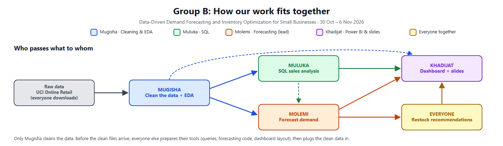
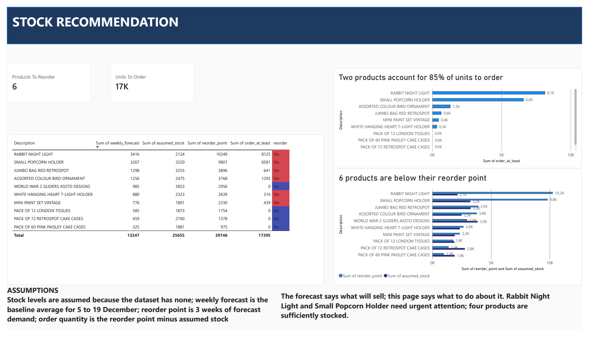
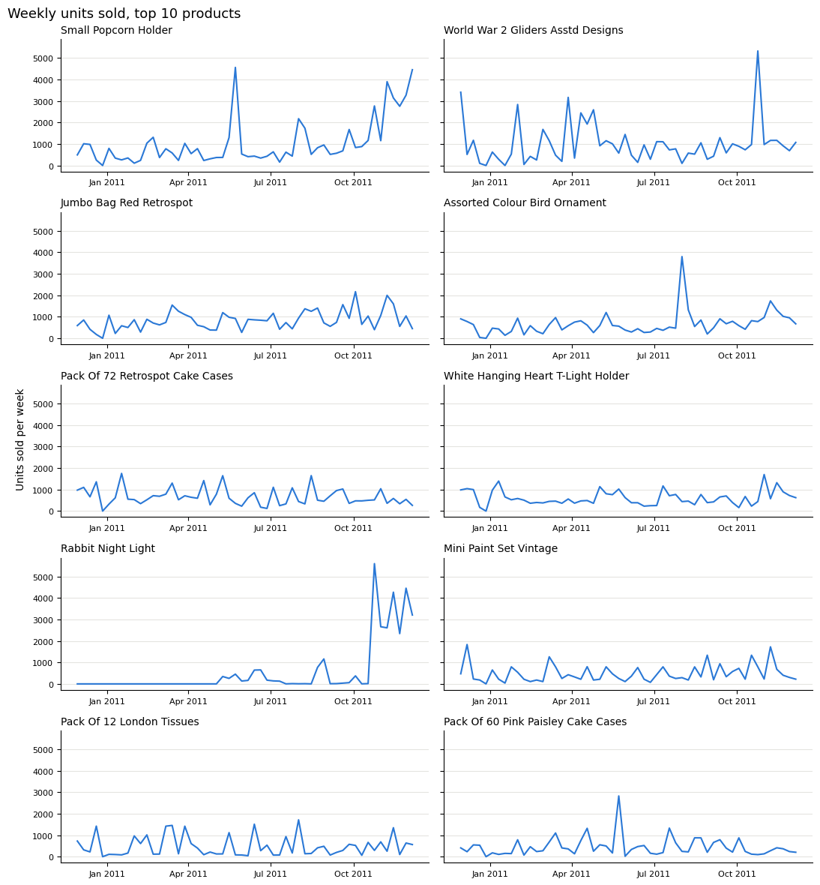
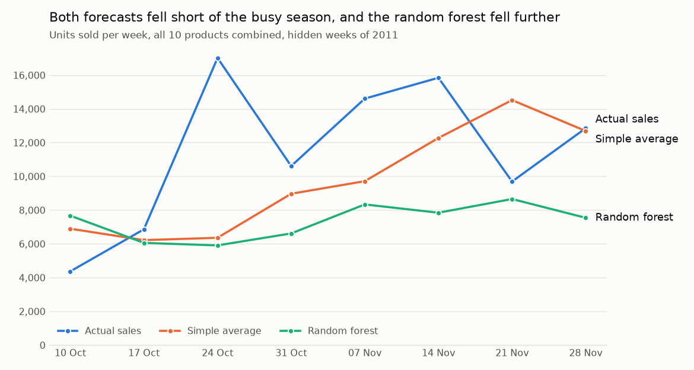

# Data-Driven Demand Forecasting and Inventory Optimization for Small Businesses

**WTM Tech Mentorship 2026 · Data Science · Group B**

We use one year of real sales data from a small online shop to predict how much of its 10 best-selling products it will sell in the coming weeks, and turn those predictions into simple restock recommendations.

> **Status:** Done. The cleaning, SQL analysis, forecasting, restock work, Power BI dashboard and presentation slides are finished (sprint 26 October – 6 November 2026). The full write-up is in the [project report](report/Group_B_Project_Report.pdf).

**Main finding:** a simple average of the last 4 weeks forecast sales better than a random forest model, so our restock recommendations use the simple average. With the assumptions we state below, the shop should reorder 6 of its top 10 products.

---

## The problem

Many small businesses decide what to restock by guesswork. Popular products run out and lose sales, while slow products sit on the shelf and tie up money.

**Who this is for:** owners and managers of small retail businesses who have sales records but no forecasting tools.

## Our question and answer

**Question:** A small shop: how much of each product will it sell in the coming weeks, and what should it buy more of?

**Our answer has two parts:**

| Part | It says |
|---|---|
| **1. Forecast** | "This product will sell about **3,400 a week**." |
| **2. Restock** | "So **buy more of it now**." (or "You have enough, don't buy.") |

**Like a weather forecast:** the forecast says *"It will rain tomorrow."* The restock part says *"So take an umbrella."* The forecast tells us what will happen; the restock part tells the shop owner what to do about it.

---

## The data

| | |
|---|---|
| **Dataset** | [Online Retail](https://archive.ics.uci.edu/dataset/352/online+retail), UCI Machine Learning Repository |
| **Business** | A UK-based online shop selling all-occasion gifts. Many of its customers are wholesalers. |
| **Period** | 1 December 2010 – 9 December 2011 (about one year) |
| **Size** | 541,909 rows (one row per product line on an invoice), about 4,000 products |
| **Columns** | `InvoiceNo`, `StockCode`, `Description`, `Quantity`, `InvoiceDate`, `UnitPrice`, `CustomerID`, `Country` |
| **File** | `Online Retail.xlsx` (Excel, 22.6 MB) |
| **Licence** | [CC BY 4.0](https://creativecommons.org/licenses/by/4.0/) |
| **Citation** | Chen, D. (2015). *Online Retail* [Dataset]. UCI Machine Learning Repository. https://doi.org/10.24432/C5BW33 |

The data is **not stored in this repo** (the files are too large). It lives in our shared [Google Drive folder](https://drive.google.com/drive/folders/1wUqEXejA86LHFEbBc9m0CmNRy1Mccc7V?usp=sharing): the original Excel file is in `data/raw/online+retail/` and the clean files are in `data/processed/`. The original file can also be downloaded from the UCI link above.

**Privacy:** customer IDs in the data are anonymous numbers. We don't use or publish any personal details.

**What the data does not have:** stock levels and supplier delivery times. Our restock recommendations therefore use clearly stated assumptions (see [Restock recommendations](#4-restock-recommendations-everyone)).

---

## Tools

| Tool | What we use it for |
|---|---|
| **Google Colab** | Writing and running our Python notebooks |
| **Python: pandas, NumPy** | Loading, cleaning and reshaping the data |
| **Python: Matplotlib, Seaborn** | Charts in the notebooks |
| **SQL (SQLite)** | Sales analysis queries |
| **Python: scikit-learn** | The forecasting model |
| **Power BI Desktop** | The dashboard |
| **Google Drive** | Storing and sharing the data files |
| **GitHub** | Storing and sharing notebooks, documents and results |

---

## How the work flows



1. **Mugisha cleans the data** and shares the clean files with everyone, including the **top 10 products** and their weekly sales.
2. **Muluka** takes the clean data and uses SQL to describe **the whole shop's past**: busy months, best and worst sellers, countries, and which products bring in most of the money. Muluka's SQL also confirms the top 10 list.
3. **Molemi** takes the weekly sales and forecasts **the future for the top 10 products only**: how many of each will sell in the next 4 weeks.
4. **Khadijat** takes Muluka's results and Molemi's forecasts and builds the Power BI dashboard and the slides.


| | Muluka | Molemi |
|---|---|---|
| Looks at | The past | The future |
| Products | All (and confirms the top 10) | Top 10 only |
| Answers | "What happened in this shop?" | "What will happen next?" |

### What gets passed along

Everything is shared through the Google Drive folder.

| What | From | To |
|---|---|---|
| Clean data | Mugisha | Everyone |
| Top 10 products list and weekly sales | Mugisha | Muluka, Molemi, Khadijat |
| SQL results | Muluka | Khadijat |
| Forecasts and restock results | Molemi | Khadijat and the whole team |

**Top products rule:** the top **10** products by **total quantity sold** over the whole dataset, grouped by `StockCode`.

---

## Method

### 1. Data cleaning and EDA (Mugisha)

Notebook: [`Member1_Data_Cleaning_and_EDA.ipynb`](notebooks/Member1_Data_Cleaning_and_EDA.ipynb)

We kept **517,350 of 541,909 rows** and removed 24,559 (4.5%):

1. **Removed exact duplicates.**
2. **Separated cancelled invoices** (numbers starting with `C`).
3. **Removed orders with a matching cancellation** (same customer, product and quantity), 5,477 rows. This matters because two very large orders, 80,995 and 74,215 units, were cancelled within minutes and would otherwise have looked like best-sellers.
4. **Kept only positive quantities and prices.**
5. **Removed non-product codes** such as postage, fees and bank charges, 2,056 rows.
6. **Kept rows with no `CustomerID`,** using -1 in its place, because they are still real sales.

The notebook then explores the data with charts and builds the top 10 list and a weekly sales table.

### 2. SQL sales analysis (Muluka)

Notebook: [`02_sql_analysis.ipynb`](notebooks/02_sql_analysis.ipynb)

We loaded the clean data into a SQLite database and wrote five queries: top 10 products by quantity, monthly revenue, top 5 countries, slow-moving products, and top 10 products by revenue.

### 3. Demand forecasting (Molemi)

Notebook: [`03_forecasting.ipynb`](notebooks/03_forecasting.ipynb)

1. **Removed the two incomplete weeks.** The first week is missing Monday and Tuesday, and the last is missing Friday afternoon and Sunday. Their low totals have nothing to do with demand. This left 52 full weeks.
2. **Hid the last 8 weeks** (10 October – 28 November 2011) to test the forecasts, and trained on the 44 weeks before them. We split by date, never at random, because a real shop only ever has the past to go on.
3. **Simple guess (baseline):** next week's sales = the average of the last 4 weeks.
4. **ML model:** a random forest using three clues: sales last week, sales 2 weeks ago, and the 4-week average. We set its settings in advance and did not change them after seeing the results.
5. **Compared both on the hidden weeks** using two error scores (see [Results](#results)).
6. **Forecast the next 4 weeks** and saved them to [`outputs/forecasts.csv`](outputs/forecasts.csv).

**Decisions we made, and why:**

- **Removed Rabbit Night Light's weeks before its first sale** (10 May 2011). Those zeros mean "not on sale yet", not "nobody wanted it".
- **Left out a near-Christmas clue,** although we planned one. Each training row needs 4 earlier weeks of sales, so no training rows fall in November or December. The model could not have learned anything from it.
- **Set the week of 26 December 2011 to 0,** because the shop made no sales from 24 December 2010 to 3 January 2011. This assumes it closes again.

### 4. Restock recommendations (everyone)

For each product: **forecast weekly sales × delivery time + safety buffer = reorder point.** If the assumed stock is below the reorder point, the recommendation is "reorder now", and the order is at least the difference. This is arithmetic, not part of the model.

**Assumptions agreed by the team.** These numbers are assumed, not measured, because the dataset has no stock or delivery data:

| Assumption | Value | In plain words |
|---|---|---|
| **Delivery time** | 2 weeks | An order takes 2 weeks to arrive |
| **Safety buffer** | 1 week of forecast sales | Spare stock in case sales or delivery are worse than expected |
| **Starting stock** | 4 weeks of the product's usual sales | The shop bought for a normal month, before the busy season |

"Usual sales" means the average week from the product's first sale up to the week of 31 October 2011. The decision is made at the start of the week of 5 December 2011, using the simple average forecast.

### 5. Dashboard (Khadijat)

- **To view it without Power BI:** [PDF copy](dashboard/Demand_forecasting_inventory_dashboard.pdf)
- **To explore it:** [`Demand_forecasting_inventory_dashboard.pbix`](dashboard/Demand_forecasting_inventory_dashboard.pbix) (open it with Power BI Desktop)
- **How it was built:** [dashboard notes](dashboard/Dashboard_README.md)

The dashboard has five pages:

1. **Business Overview:** total revenue, monthly revenue and the top markets.
2. **Product Performance:** the top products by units and by revenue, and products that sold only one unit.
3. **Demand Forecasting:** actual sales against both forecasts for a chosen product, and the forecast for the next 3 weeks.
4. **Model Evaluation:** MAE and RMSE for both methods, overall and for each product.
5. **Stock Recommendations:** reorder points, assumed stock and how much to order.



---

## Results

### What happened in the shop

- **Busiest month:** November 2011, with revenue of about 1,428,157 out of 9,710,101 for the whole period. December 2011 looks low only because the data stops on 9 December.
- **Biggest market:** the United Kingdom, with about 8,225,772 in revenue (85% of the total). The Netherlands, EIRE, Germany and France follow.
- **Selling the most is not the same as earning the most:** Regency Cakestand 3 Tier earned the most money (about 166,257), but it isn't in the top 10 by quantity.
- **Slowest products:** these are tied, with the 10 listed selling only one unit each, so they are examples rather than "the 10 worst". One of them is a gift voucher, not stock on a shelf.

### What sales looked like



- **Sudden spikes:** some products jump for a single week. Past sales alone can't predict these.
- **Two products take off late:** Small Popcorn Holder and Rabbit Night Light climb sharply from about late October.
- **Others stay steady:** Jumbo Bag Red Retrospot and White Hanging Heart go up and down, but stay in a fairly narrow range.

### How good were the forecasts?

| Method | MAE (units) | RMSE (units) |
|---|---|---|
| **Simple average (baseline)** | **593.9** | **1028.2** |
| Random forest | 708.1 | 1201.5 |

- **MAE** is the average miss, ignoring whether it was too high or too low. The simple average was off by about 594 units per product per week.
- **RMSE** is similar, but big misses count much more. It is well above the MAE here because a few very large misses push it up.
- **For both scores, lower is better, so the simple average won.**



**Why the simple method won:** the hidden weeks averaged about twice the sales of the training weeks (1,148 against 585 units per product per week). A random forest predicts by averaging similar past weeks, so its highest forecast was 1,314 units, while actual sales reached 5,593. The simple average rises as recent sales rise, so it kept closer, although it was often a few weeks late. The random forest did better on 3 of the 10 products (World War 2 Gliders, Jumbo Bag and Mini Paint Set), but worse overall.

**How we checked these results:**

- The test used only weeks hidden from training, and every clue used only earlier weeks.
- The random forest lost with all 5 other random seeds we tried (MAE between 696 and 703), so this was not bad luck.
- We checked the cleaned-data totals, top 10 and revenue figures against the raw data, using separate code.

### What the shop should do

Forecast for the weeks of 5, 12 and 19 December 2011, with 0 for the week of 26 December:

| Product | Forecast per week | Reorder point | Assumed stock | Reorder? | Order at least |
|---|---:|---:|---:|---|---:|
| Rabbit Night Light | 3,416 | 10,249 | 2,124 | **Yes** | 8,125 |
| Small Popcorn Holder | 3,267 | 9,801 | 3,220 | **Yes** | 6,581 |
| Assorted Colour Bird Ornament | 1,256 | 3,768 | 2,475 | **Yes** | 1,293 |
| Jumbo Bag Red Retrospot | 1,298 | 3,896 | 3,255 | **Yes** | 641 |
| Mini Paint Set Vintage | 776 | 2,330 | 1,891 | **Yes** | 439 |
| White Hanging Heart T-Light Holder | 880 | 2,639 | 2,323 | **Yes** | 316 |
| World War 2 Gliders | 985 | 2,956 | 3,853 | No | 0 |
| Pack of 12 London Tissues | 585 | 1,754 | 1,873 | No | 0 |
| Pack of 72 Retrospot Cake Cases | 459 | 1,378 | 2,760 | No | 0 |
| Pack of 60 Pink Paisley Cake Cases | 325 | 975 | 1,881 | No | 0 |

**How firm this is:** we tried 9 combinations of delivery time, buffer and starting stock. Rabbit Night Light and Small Popcorn Holder always needed reordering, Assorted Colour Bird Ornament needed it in 8, and both Cake Cases products never did. The other five depend more on the assumptions.

**Caution:** an order placed on 5 December would arrive around 19 December, just before the likely Christmas closure, and these products' sales fell week by week at that time last year (7,690, then 5,871, then 4,246 units). These numbers are a starting point, and the shop owner makes the final decision.

The results are in [`outputs/forecasts.csv`](outputs/forecasts.csv) and [`outputs/restock.csv`](outputs/restock.csv).

## Limitations

What our project **can't** do, or where its results should be used with care.

- **About one year of data:** the model sees the Christmas peak only once, so it cannot learn yearly patterns.
- **One-week-ahead test:** we tested forecasts one week ahead, but the final forecast goes up to 4 weeks ahead, so its real errors may be larger.
- **December forecasts may be too high:** the forecasts for 12 and 19 December don't include last year's fall before Christmas.
- **Sudden spikes:** one-week jumps can't be predicted from past sales alone.
- **Sales are not the same as demand:** we have no stock data, so a product that ran out would look like it had low demand.
- **No real stock or supplier data:** restock recommendations rely on assumptions.
- **Christmas closure is an assumption:** it is based on what happened in one year.
- **One UK online gift shop, with many wholesale customers:** results may not transfer directly to other kinds of small businesses.

## What we learned

- **Test a complex model against a simple one.** The random forest sounded stronger, but the simple average did better on our test.
- **Check the data behind the headline numbers.** Two apparent best-sellers turned out to be huge orders that were cancelled within minutes.
- **A good idea can still be unusable.** We planned a near-Christmas clue, then dropped it when we found no training rows in November or December.
- **State assumptions, and test them.** Trying 9 combinations showed which restock decisions hold up and which depend on what we assumed.

## Next steps

What we would do next with more time or more data.

- **Use several years of sales,** so a model can learn the Christmas pattern.
- **Use the shop's real stock levels and delivery times** in place of our assumptions.
- **Test forecasts 4 weeks ahead,** to match how the shop would really use them.
- **Add known events,** such as promotions and large wholesale orders, to help explain sudden spikes.
- **Extend beyond the top 10 products,** including the many that sell slowly.
- **Give a range, not a single number,** so the owner can see how uncertain each forecast is.

---

## Scope

**In scope:** weekly forecasts, 4 weeks ahead, for the top 10 products; one baseline and one ML model compared with each other; restock recommendations based on stated assumptions; a Power BI dashboard.

**Out of scope:** all ~4,000 products (too many, and most barely sell); real stock or supplier data (the dataset has none).

---

## How to run

The notebooks run in **Google Colab**.

1. Clone the repo:
   ```
   git clone https://github.com/Mo-lemi/WTM-Data-Science-Group-B.git
   ```
2. Open the [shared Google Drive folder](https://drive.google.com/drive/folders/1wUqEXejA86LHFEbBc9m0CmNRy1Mccc7V?usp=sharing) and add a shortcut to it in your own My Drive (right-click → **Organize → Add shortcut → My Drive**), so Colab can find the data.
3. Open the notebooks in Google Colab and run them in order: `Member1_Data_Cleaning_and_EDA.ipynb` → `02_sql_analysis.ipynb` → `03_forecasting.ipynb`.

Running a notebook overwrites its result files in the Drive folder. The libraries we use are already included in Colab.

## Repository structure

```
WTM-Data-Science-Group-B/
├── notebooks/        Colab notebooks, one per team member
├── outputs/          Small result files (weekly sales, SQL results, forecasts, restock)
├── images/           Charts used in this README and the report
├── report/           Project report (PDF and Word)
├── dashboard/        Power BI file, its PDF copy and notes on how it was built
├── PLAN.md           Project plan
├── PLAN_flow.png     Workflow diagram
└── README.md         This file
```

The data and the presentation slides are **not** in this repo. They're in the shared [Google Drive folder](https://drive.google.com/drive/folders/1wUqEXejA86LHFEbBc9m0CmNRy1Mccc7V?usp=sharing), in `data/` and `slides/`.

---

## Team

| Member | Role | Contribution |
|---|---|---|
| Mugisha Elisa | Member 1: Data cleaning & EDA | Wrote the original cleaning and EDA notebook: data understanding, cleaning, charts, the top 10 list and the weekly sales table. |
| Muluka Zerga Lendino | Member 2: SQL & sales analysis | Built the SQLite database and wrote the five sales queries, then re-ran them on the corrected data. |
| Molemi Molokoane | Member 3: Demand forecasting & evaluation · Team lead | Built the forecasts and their evaluation, drafted the restock assumptions and calculation, corrected the cleaning notebook, prepared the README and report, and led the team. |
| Khadijat Ozohu Yusuf | Member 4: Power BI dashboard & slides | Built the five-page Power BI dashboard, wrote the first version of its notes, and prepared the presentation slides. |

**Where members changed each other's work:**

- **Cleaning notebook:** Molemi corrected the handling of orders cancelled later, the top 10 grouping, the weekly sales table and the non-product charges. Mugisha also applied the first three of these fixes in a separate copy. The team kept Molemi's version, which used the shared Drive paths.
- **SQL notebook:** Molemi added a cell that displays Muluka's results in the notebook, and re-ran it.
- **Dashboard:** Molemi corrected wording and tidied the charts in Khadijat's dashboard, exported the PDF copy, and corrected the dashboard notes to match the final file.

The whole team agreed the restock assumptions, and each member presents their own contribution.

See [PLAN.md](PLAN.md) for the full project plan.
